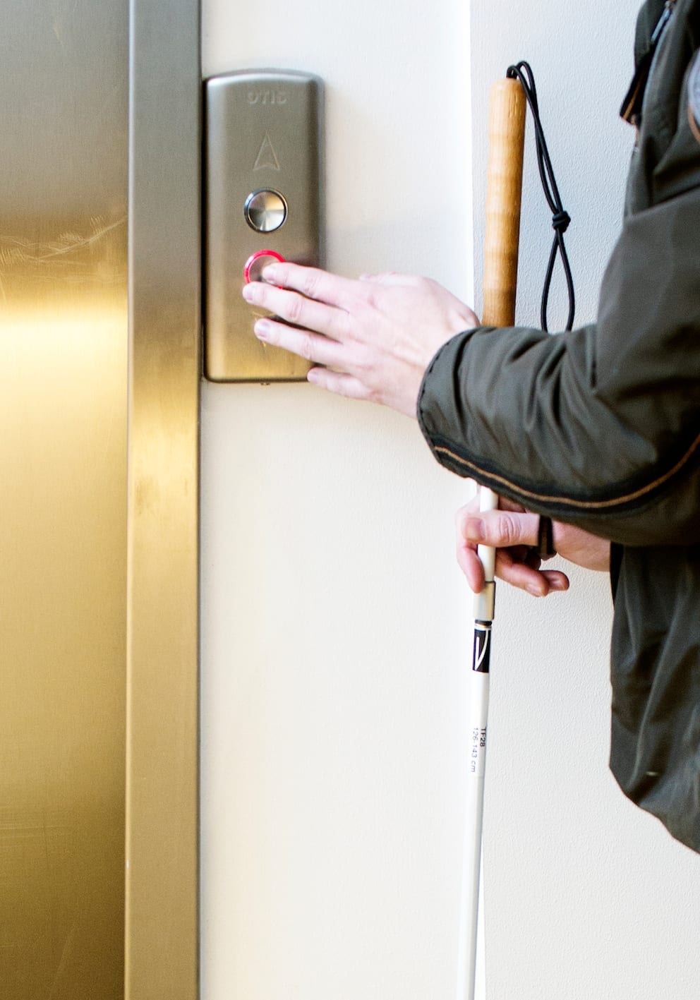
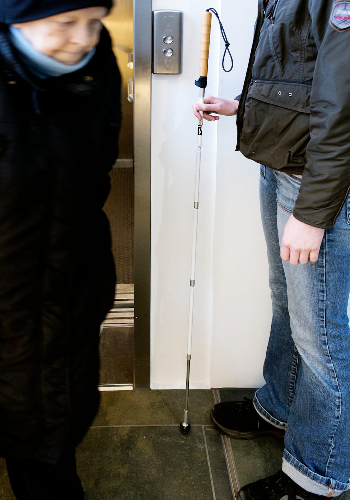
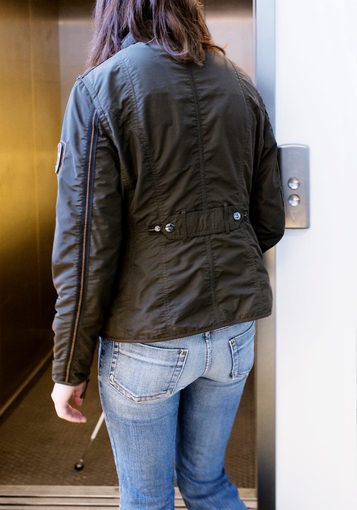
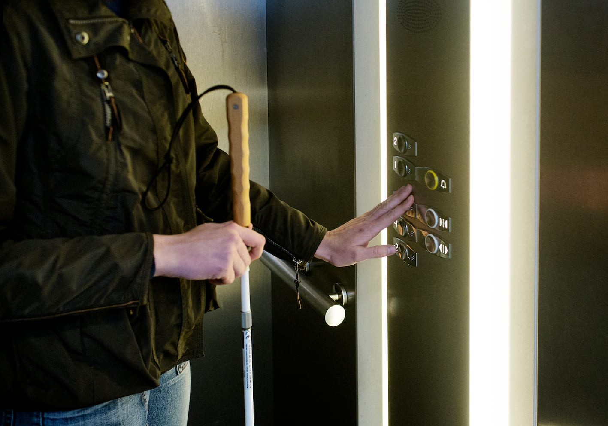
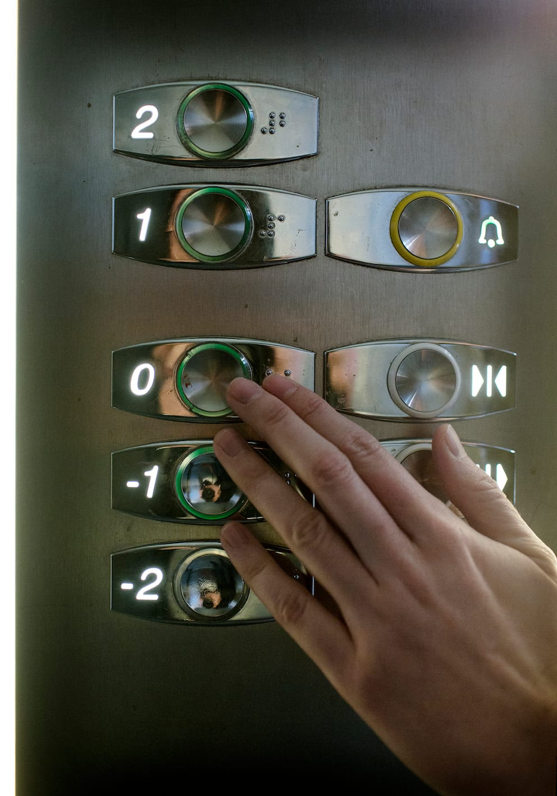
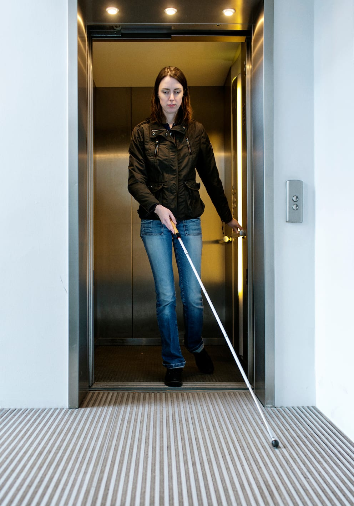

# Elevator

- Lykke kan lokalisere elevatoren ved at lytte efter de lyde, som kan være forbundet med en elevator. Det kan være en klokke, en dør der åbner, lyden af andre fodgængeres trin m.m. Der kan også være taktile markeringer i underlaget og specielle lysforhold. Det kan være nødvendigt at henvende sig til andre for hjælp.

- Her finder Lykke tilkaldeknappen og aktiverer den rigtige knap. Tilkaldeknapperne er som regel placeret på væggen til højre for elevatordøren.

- Når elevatoren ankommer, giver Lykke plads for udstigning.

- På vej ind i elevatoren er det en god idé at anvende kort stok. Lykke undersøger gulvet i elevatoren med et pendulsving for at sikre, at elevatoren faktisk er der, og at døren ikke bare er gået op ved en fejltagelse. Man kan evt. anvende beskyttelsesteknik (høj arm) for at sikre sig mod døre, der lukker.

- Inde i elevatoren vender Lykke front mod døren, lokaliserer betjeningspanelet og aktiverer den aktuelle knap.

- Hvis der ikke er punktskrift på betjeningspanelet, kan det være en mulighed at indhente tilladelse hos ejeren til selv at anbringe en form for afmærkning på betjeningspanelet.

- Hvis etagerne ikke bliver annonceret, må Lykke undersøge, om hun er kommet til den rigtige etage på anden vis. Det kan være ved at spørge, lytte til kendte lyde, registrere særlige kendetegn og lugte m.m. Det kan evt. være nødvendigt at forlade elevatoren for at opsøge et kendemærke. Måske kan man tælle etager, hvis der er lydlige indikatorer, eller måske kan man måle køretiden. Hvis det er teknisk muligt, kan man trykke på alle knap-perne for de mellemliggende etager for dermed at kunne tælle sig frem.

- Når elevatoren forlades er det vigtigt, at stokken har kontakt med gulvet udenfor for at sikre, at elevatorens gulv er i niveau. Det er også her hensigtsmæssigt at benytte kort stok for at undgå at ramme eventuelle personer, der venter på elevatoren.

