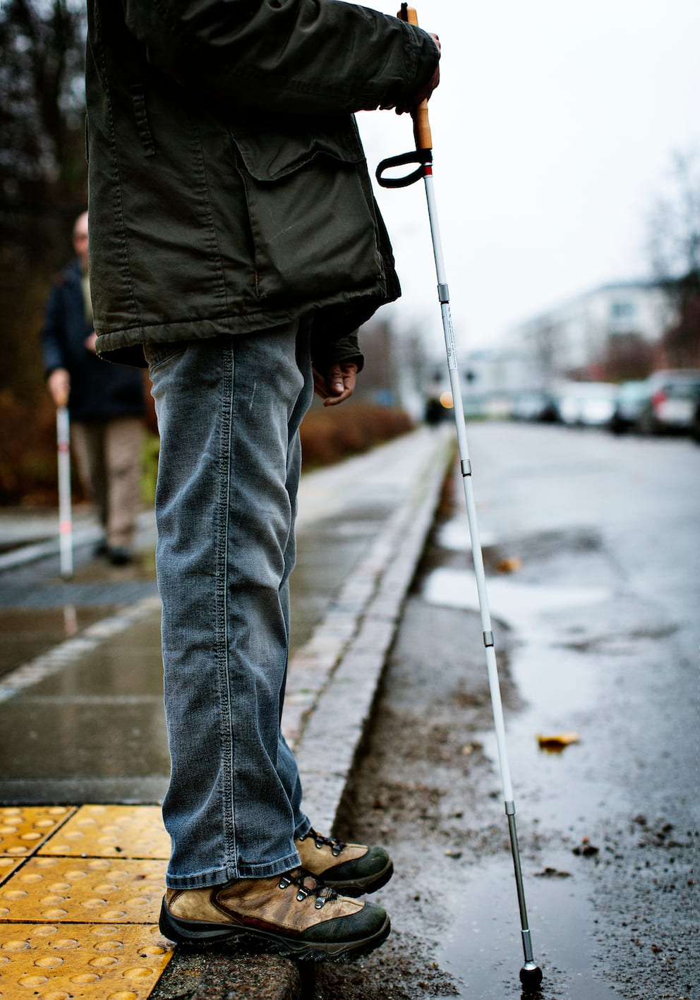
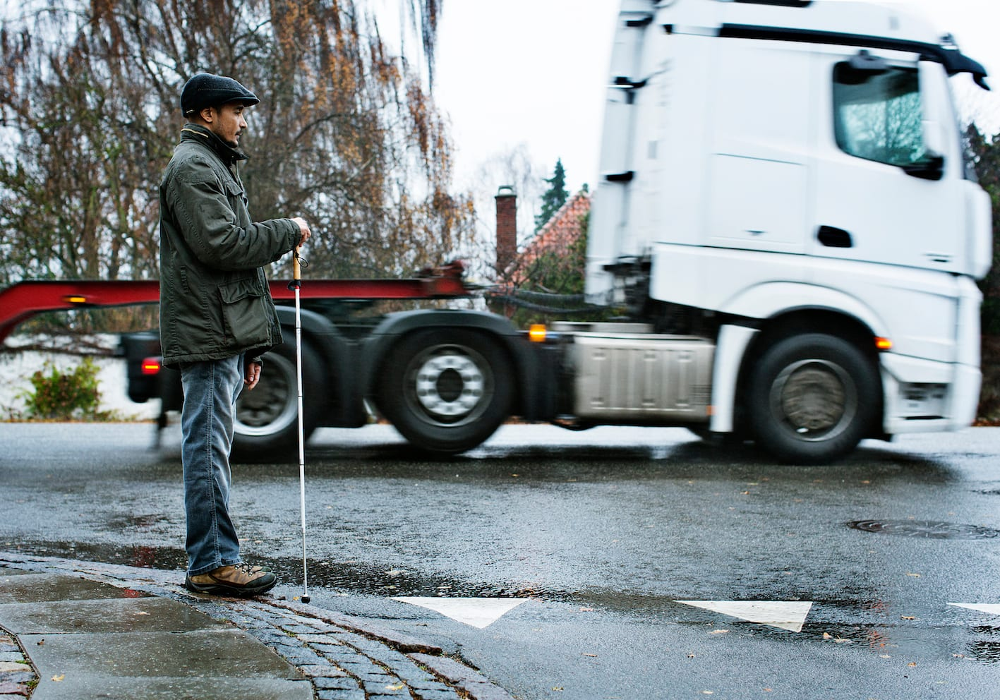

# Introduktion – krydsning af veje

Når man som person med blindhed krydser en vej, må man anvende omgivelserne til at sikre sig, at man kommer lige over gaden og dermed opholder sig på vejbanen så kort tid som muligt. En lige kantsten kan være en god retningsgiver. Alternativt kan et andet kendt objekt (fx et kendemærke) måske fungere som den nødvendige retningsgiver, eller man kan benytte lyden fra den parallelle trafik til at anvise retningen (hørekrydsning).

