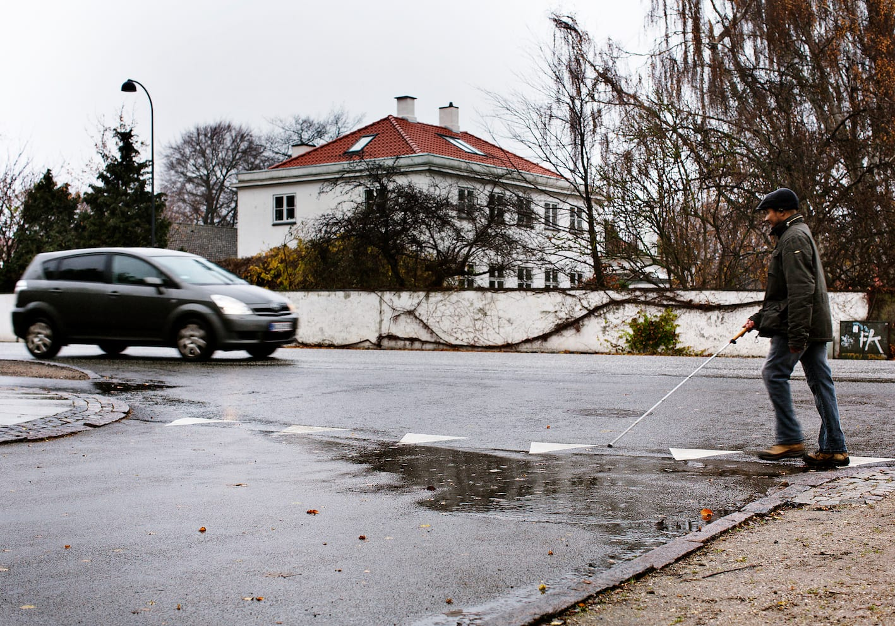

# Introduktion - hørekrydsning

Hørekrydsning er en metode til at krydse en sidevej direkte fra hjørne til hjørne.
Ved hørekrydsning benytter man lyden af den parallelle trafik til at afgøre, hvornår og hvordan man kan krydse. Metoden kræver en hvis mængde stabil trafik. Den er mere effektiv og orienteringsmæssigt lettere end sikkerhedskrydsning, idet gangretningen bibeholdes. Man kan kun hørekrydse i kendte omgivelser, da man skal være sikker på, at der befinder sig et fortov på den anden side, når man krydser i en lige linje.

