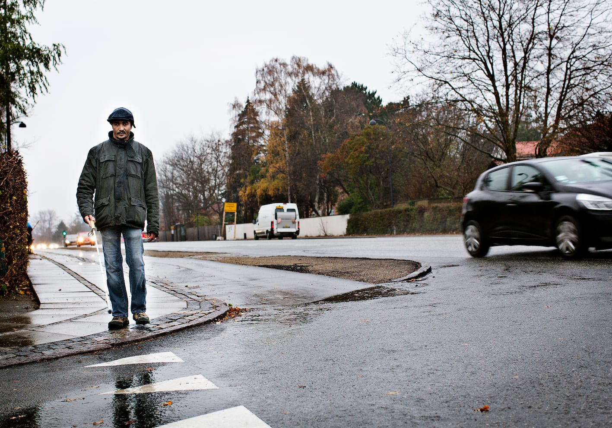
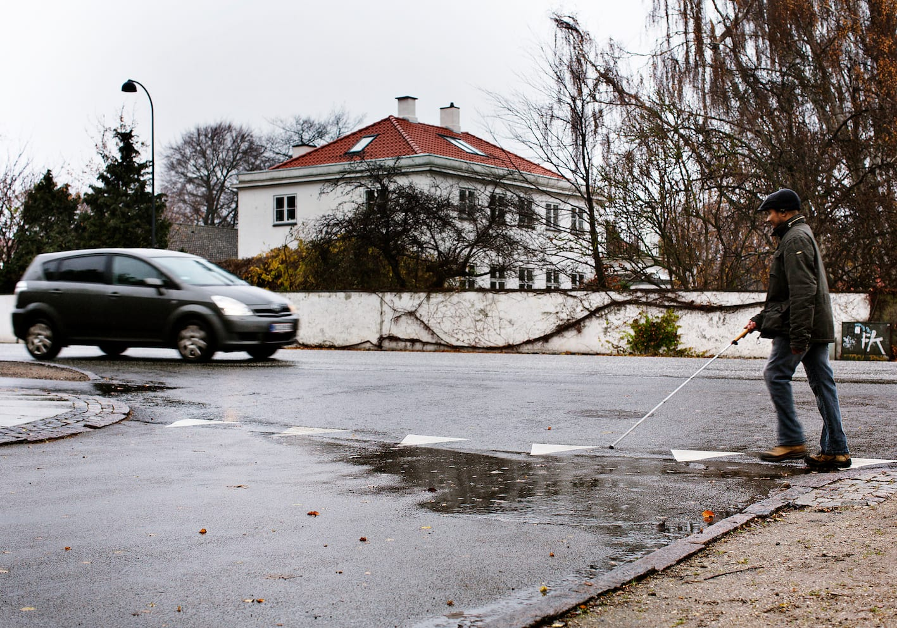

# Hørekrydsning

- Når Magd ankommer til hjørnet af sidevejen, stopper han op og bibeholder så vidt muligt retningen.

- Hvis der er behov for at korrigere retningen, lytter han til den parallelle trafik og justerer ved at dreje på stedet.

- Efter behov tjekkes med stokken, om vejen er fri umiddelbart foran fødderne.

- Magd afventer et hul i paralleltrafikken for at høre, om der holder biler, som venter på sidevejen.

- Magd skal nu benytte lyden fra bilerne i den parallelle vejbane tættest på ham til at foretage krydsningen. Han kan gå, når den første bil i en række af biler kommer. Derved dannes en sidelinje, hvorved trafikken fra sidevejen afskæres, ligesom der er lukket for venstresvingende biler fra den fjerneste vejbane.

- Afhængig af hvilken retning Magd krydser, vil bilerne køre hhv. med eller imod Magds gangretning. Det er lettest at krydse i samme retning som bilerne.

__Med trafikken__

- Her ses Magd udføre en hørekrydsning med trafikken. Dvs. at han følges med de biler, som kører i den samme retning, som han går.

- Magd går, når bilen er lige ud for ham, og han dermed er sikker på, at den ikke drejer rundt om hjørnet.

- Hvis den anden bil i rækken skal dreje, sætter den farten ned, og i det hul er Magd passeret forbi.

__Imod trafikken__

- Magd udfører her en hørekrydsning imod trafikken. Dvs. at han følges med de biler, som kører modsat den retning, som han går.

- Han går, når den første bil i en række af biler er 4-5 meter væk. Svarende til ud for det modsatte gadehjørne.
