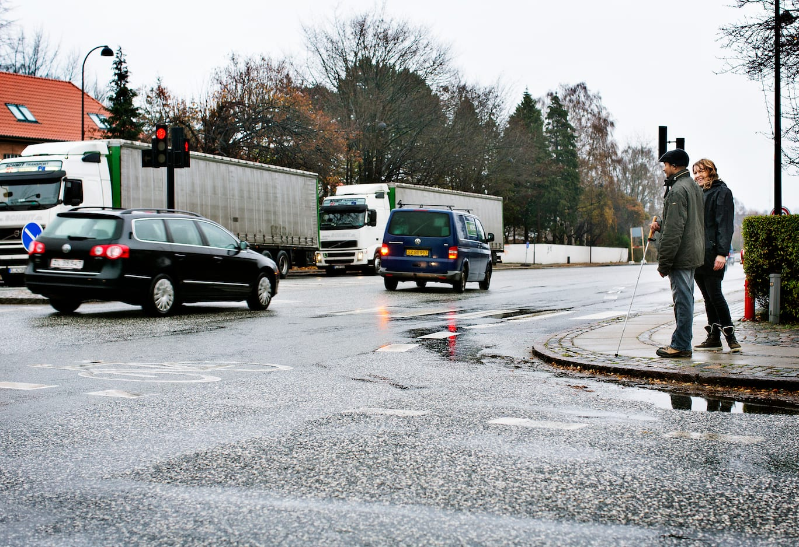

# Introduktion - lyskryds

Færdsel i lyskryds er en kompleks opgave, som indeholder flere risikomomenter, og som kræver gode O&M-forudsætninger hos personen med blindhed. Blandt de mange forudsætninger er evnen til at gå lige, evnen til at gå i et relativt højt tempo, en velfungerende hørelse, god orienteringsevne samt kendskab til, hvordan trafik kan reguleres i forskellige former for lyskryds.

Der er ligeledes flere forhold omkring selve lyskrydset, som kan have betydning for, om personen kan få den nødvendige information for at kunne krydse sikkert og selvstændigt. Det kan være risiko for kødannelse, skæve vinkler, dårlige oversigtsforhold for bilisterne o.l.  Det vil være for omfattende at komme ind på alle elementer i denne app. For en mere detaljeret gennemgang af de væsentlige forudsætninger og den praktiske udførelse henvises til O&M-uddannelsen.

Det er nødvendigt, at personen ved, hvordan det pågældende lyskryds er bygget op, og hvordan trafikken er reguleret (trafikmønstret). Det er bl.a. nødvendigt at vide, hvor mange faser der er i krydset, og hvornår de enkelte faser afvikles. Personen må derfor indledningsvis foretage en analyse af lyskrydset i samarbejde med O&M-instruktøren. Dette kan fx gøres ved at blive ledsaget rundt i krydset og ved at foretage en akustisk analyse af krydset, hvor det kortlægges, hvordan trafikken er reguleret.

