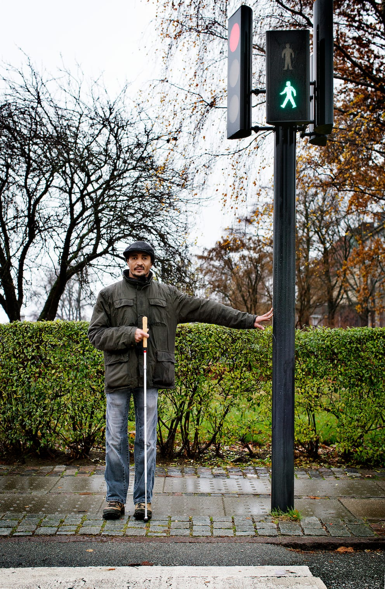
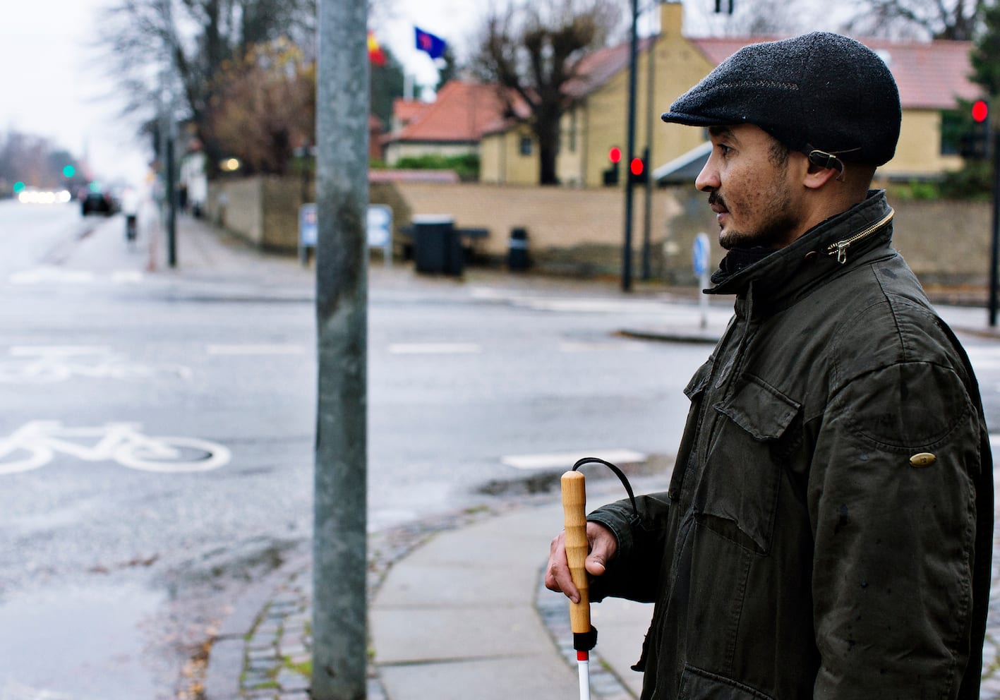
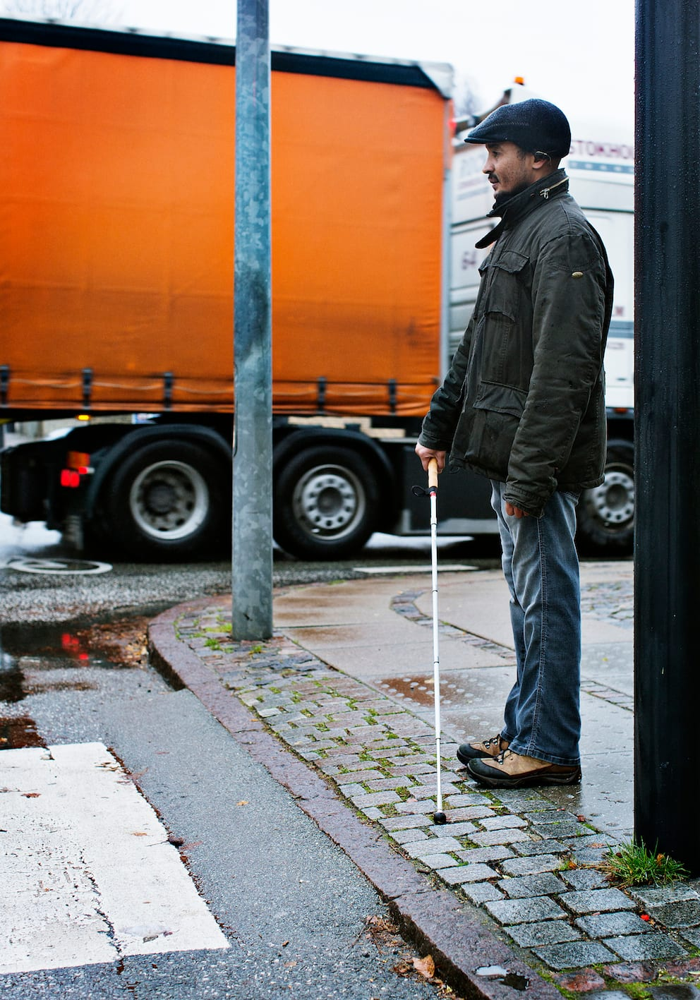
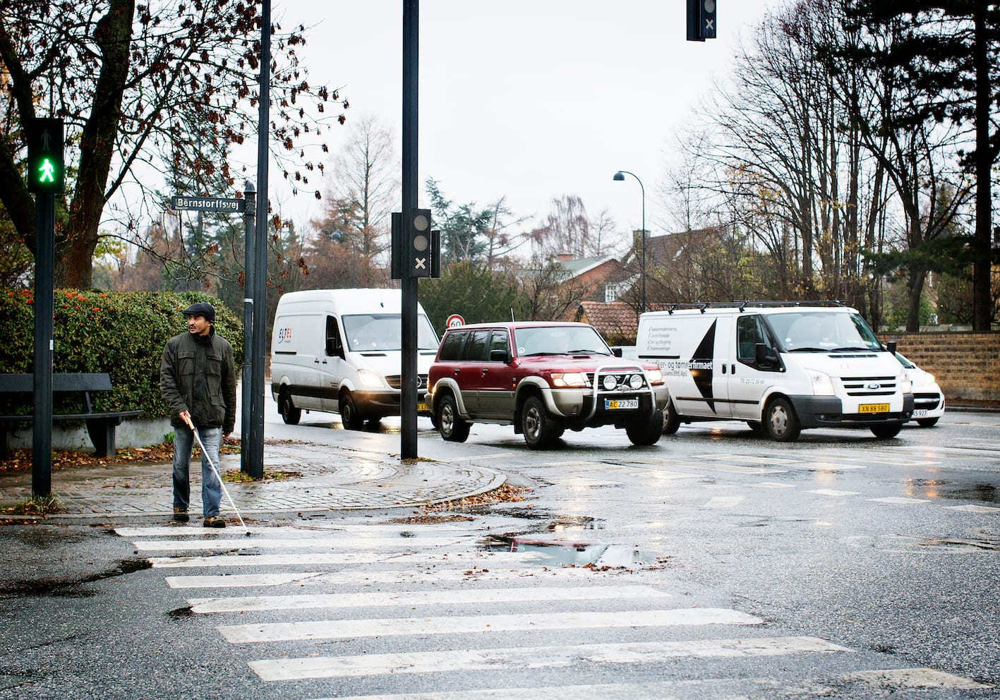
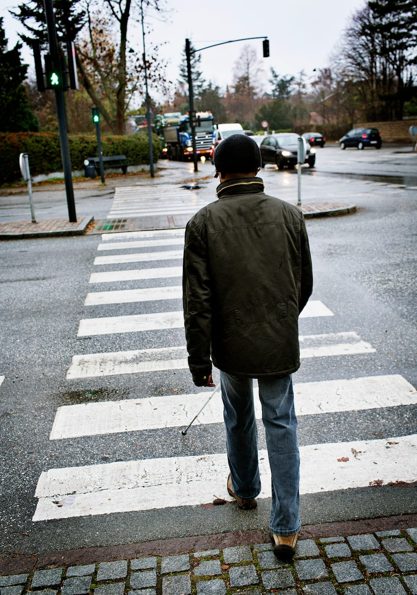
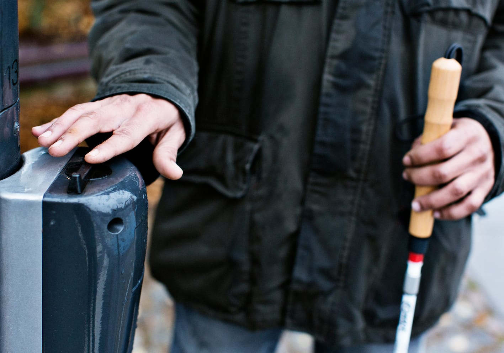

# Lyskryds

De tre H’er: Hvor, Hvordan og Hvornår kan bruges som tommelfingerregel for, i hvilken rækkefølge man skal løse opgaverne, når man kommer til et lyskryds og skal forberede sig på at krydse vejen.

__Hvor krydses vejen i et lyskryds?__

Dette kan afgøres både auditivt og ved brug af taktile kendemærker.

- Der krydses ved fodgængerfeltet, som typisk er ca. 4 m bredt. Det befinder sig mellem paralleltrafikken og stoplinjen fra tværtrafikken. Her kan man, ved at lytte sig frem, placere sig i afstanden 1/3 fra stoplinjen og 2/3 afstand fra paralleltrafikken. Det kan også være en hjælp at lytte til, hvor de andre fodgængere står.

- I de fleste tilfælde står lyskurvens mast på ydersiden af fodgængerfeltet væk fra krydset. Hvis positionen er kendt, kan den bruges til kendemærke. Magd stiller sig mellem lysmasten og krydset og retter ind.

- Hvis der ikke er en lysmast, kan man fx bruge en barnevognsrampe eller andet, som er velegnet som kendemærke. Evt. må man finde et kendemærke i inderlinjen og tage retning efter det.

__Hvordan krydses (i hvilken retning)?__

- Der lyttes til mindst én omgang af faserne for at kunne tage retning efter paralleltrafikken. Det er nødvendigt at kunne rette ind efter paralleltrafikken, hvis krydset er skævt eller kantstenen buet. Også under krydsningen benyttes paralleltrafikken som retningsgiver.

__Hvornår kan man krydse?__

- Når paralleltrafikken starter. I begyndelsen af paralleltrafikkens grønne fase har fodgængerne grønt lys. Denne regel kan kun anvendes i 2-fasede kryds.

- Magd går, når den første holdende bil i det parallelle spor er kørt et par meter. Så er han sikker på, at den ikke kun ”gasser op”. Krydsningen foregår i et relativt hurtigt tempo.

- I lyskryds med mere end 2 faser kan man kun krydse vejen samtidig med den startende trafik i det parallelle spor, der er tættest på (som ved hørekrydsning). Der kan dog være tilfælde, hvor denne metode ikke fungerer, hvorfor det naturligvis altid er vigtigt at O&M-instruktøren foretager en grundig analyse af det enkelte lyskryds, inden det afprøves i praksis.

## Lydfyr

Et lydfyr kan være en stor hjælp både til at afgøre, hvor fodgængerfeltet befinder sig, og hvornår der er grønt lys. Når lydfyret giver et hurtigt skiftende lydsignal angiver det, at der er grønt, mens en langsomt skiftende lydsignal fortæller, at der er rødt. Lydfyret er typisk placeret i den side af fodgængerfeltet, der vender væk fra krydset.

På oversiden af boksen med lydgiveren er ofte anbragt en ophøjet retningspil, som skal angive retningen. Én knop på retningspilen fortæller, at fodgængerfeltet går ubrudt fra fortov til fortov. To knopper fortæller, at der er en helle undervejs. (Kilde: www.sbi.dk)
Ved henvendelse til teknisk forvaltning vil det i mange tilfælde være muligt at få opsat lydsignal i bestemte kryds.

