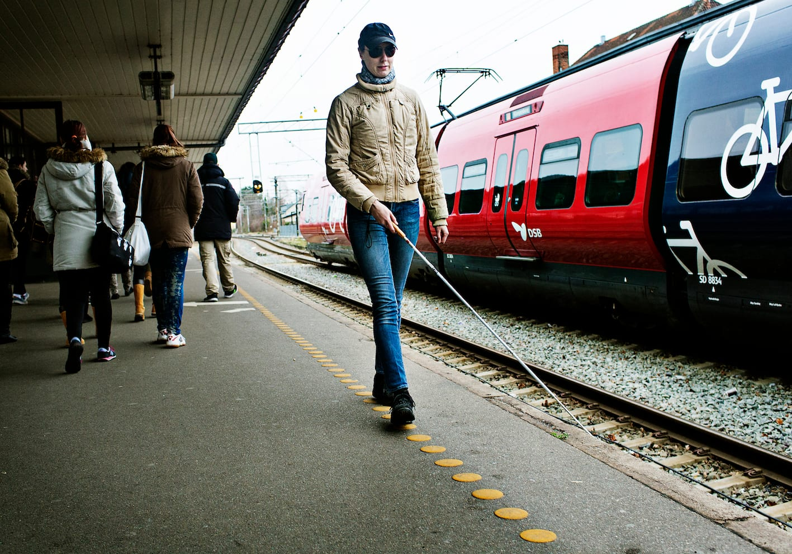
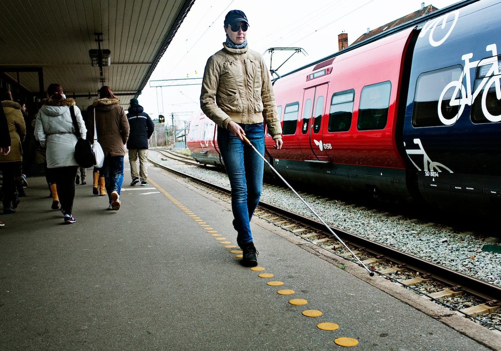
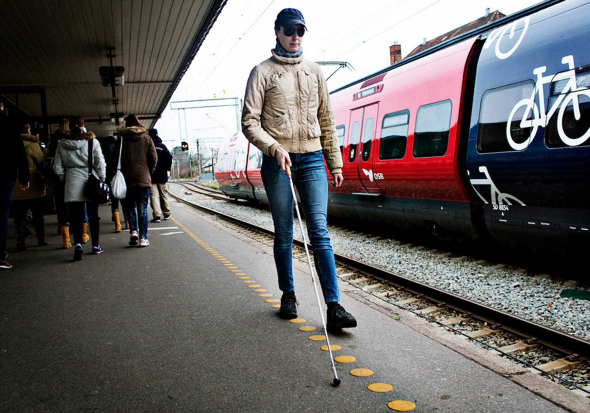
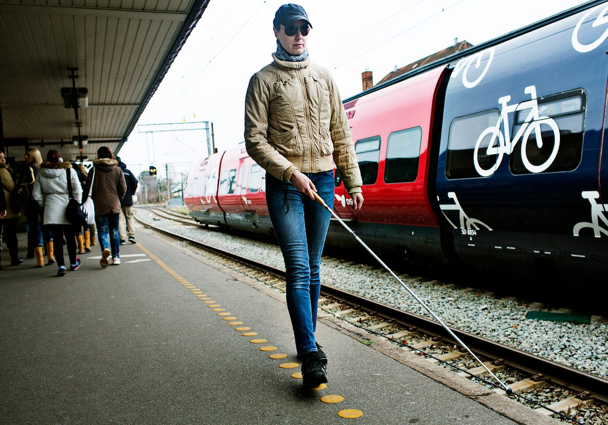
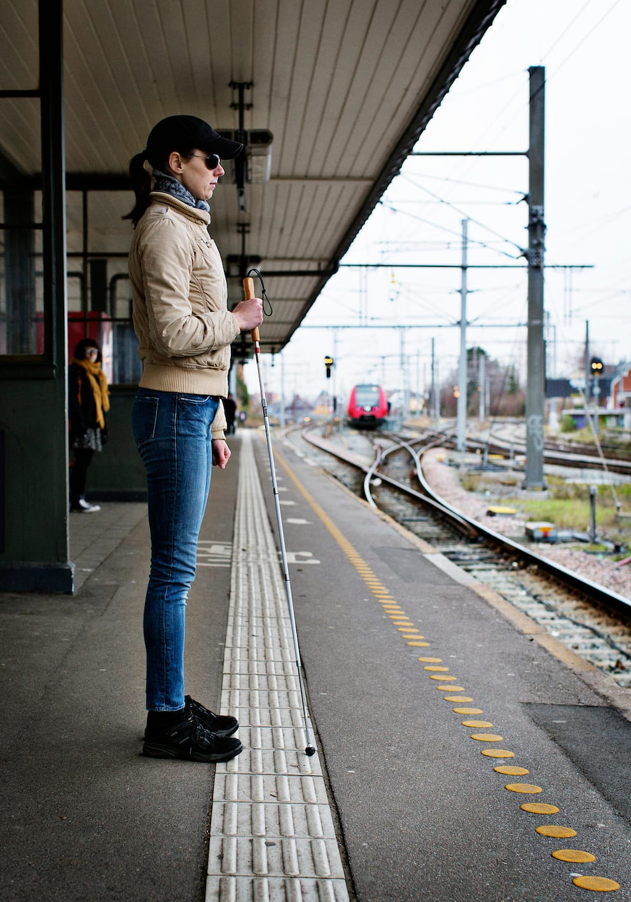

# Færdsel på perron

Når personen med blindhed færdes hen ad perronen, foregår det med en bred pendulteknik på én af følgende 3 måder:

__1. Trailing langs perronkanten__

- Lykke trailer langs perronkanten ved at lade hvert bueslag mod perronkanten have kontakt med kanten. Buen må gerne være ekstra bred, men det er vigtigt at hånden stadigvæk holdes i midten for at bevare referencepunktet i forhold til spidsen.

- Så snart Lykke hører et tog, træder hun væk fra kanten og står stille.

__2. Trailing langs en anden ledelinje__

- På mange stationer vil der efterhånden være nedlagt specielle ledelinjer til brug for personer med synsnedsættelse eller blindhed. Lykke har her benyttet ledelinjen til at finde hen ad perronen for at vente på toget.

- Andre steder er det muligt at finde en ”naturlig” ledelinje i form at en linje dannet af forskellige belægninger, fx en rist parallelt med sporet eller lignende.

__3. Færdsel midt på perronen__

- Lykke kan også vælge at gå inde på perronen ved at have kontakt med inventaret (bænke, læskure, skilte osv.), eller måske kan hun følge auditive ledelinjer, fx i form af lyden fra de andre passagerer.
