# Indstigning

- Lykke nærmer sig perronkanten vinkelret med en bred pendulteknik, hvor kontakten holdes med underlaget hele tiden. Kanten af perronen er ofte markeret med en forandring i underlaget.

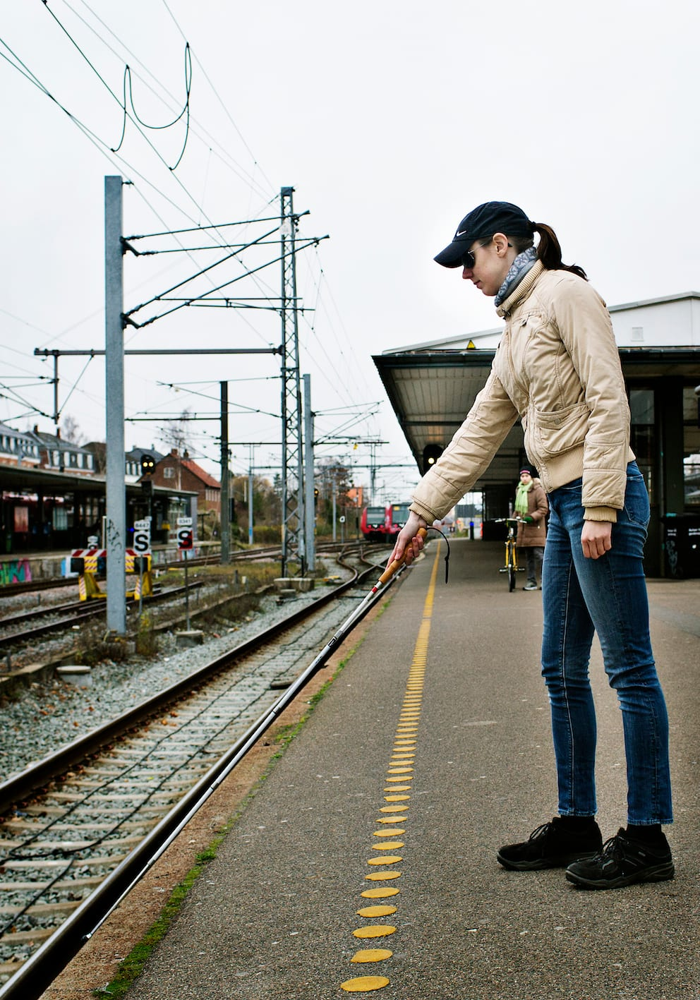

- Når perronkanten er lokaliseret, trækker Lykke sig så langt væk fra kanten, at hun lige kan nå den med stokkespidsen, for at vente på toget.

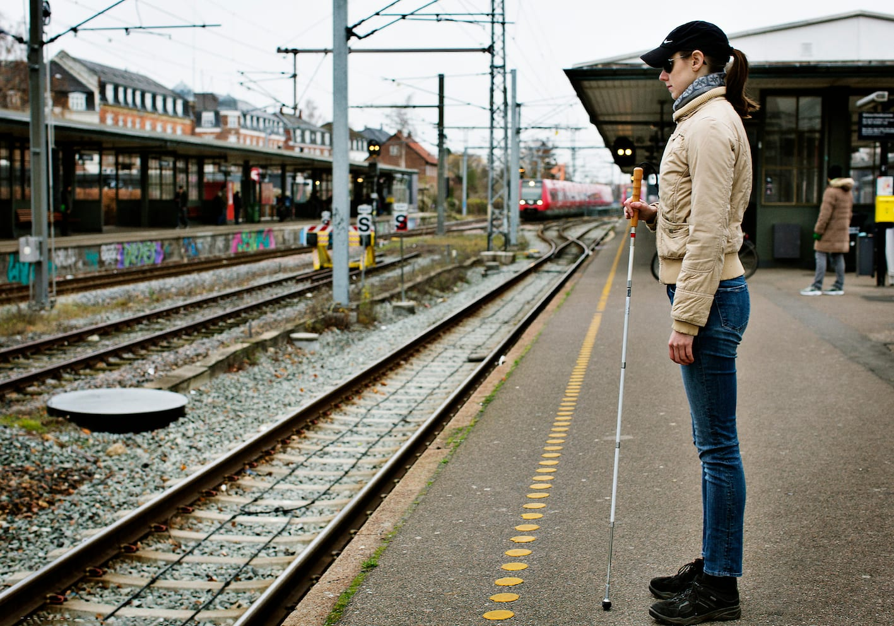

- Når toget holder, lytter Lykke efter, hvor dørene åbner og passagerer går ud og ind af toget. Hun går da ud til togvognen og bestemmer sig hurtigt for, om hun vil gå til højre eller venstre alt efter, hvor døren tættest på er.

- Hvis det ikke er muligt at høre, hvor der er en dør, vender Lykke sig i togets kørselsretning og går langs med toget. Herved vil togføreren have mulighed for at se den hvide stok og tage hensyn ved at give den ekstra tid, der kan være nødvendig for at finde ind i toget.

- Lykke anvender her diagonalteknik, mens hun trailer med hånden på siden af toget  for at lokalisere døren. Diagonalteknikken giver ingen beskyttelse mod forhindringer som fx stående bagage.

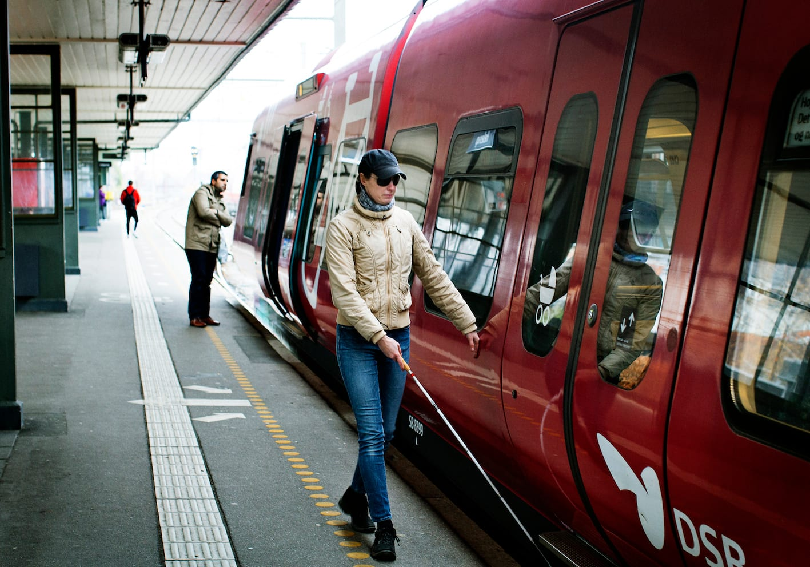
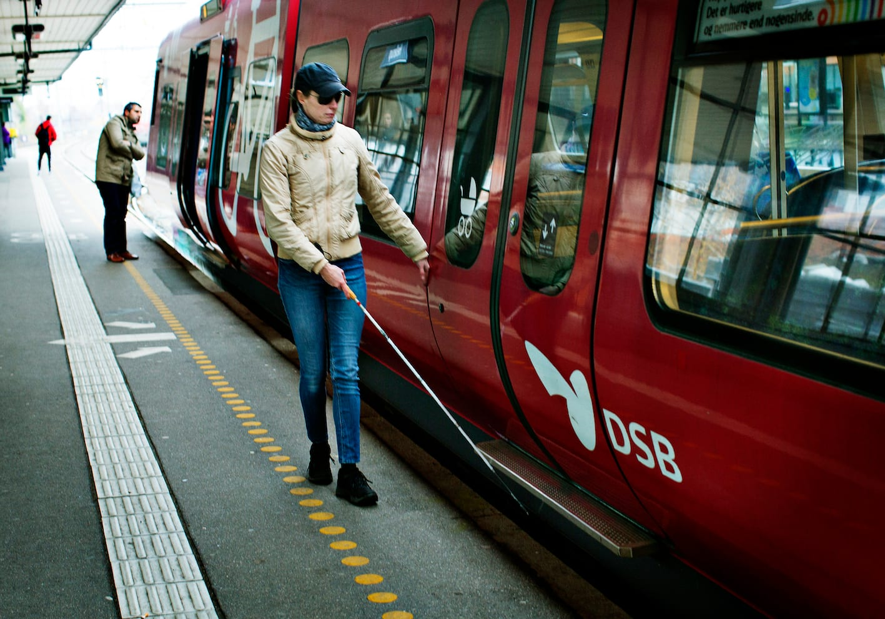

- Lykke kan også vælge at anvende pendulteknik evt. ved brug af tre-punkt-teknik (perron-kant-tog), hvis toget har et udvendigt trin foran døren.

- Når døren er fundet, lokaliseres knappen/dørgrebet med hånden eller lodret stok og døren åbnes.

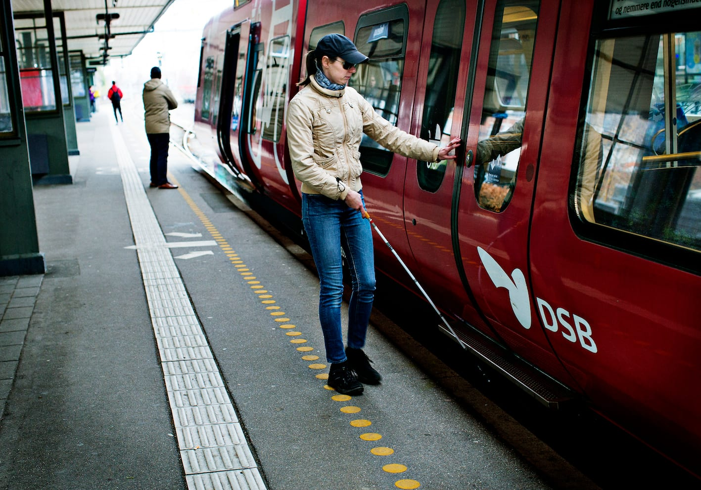
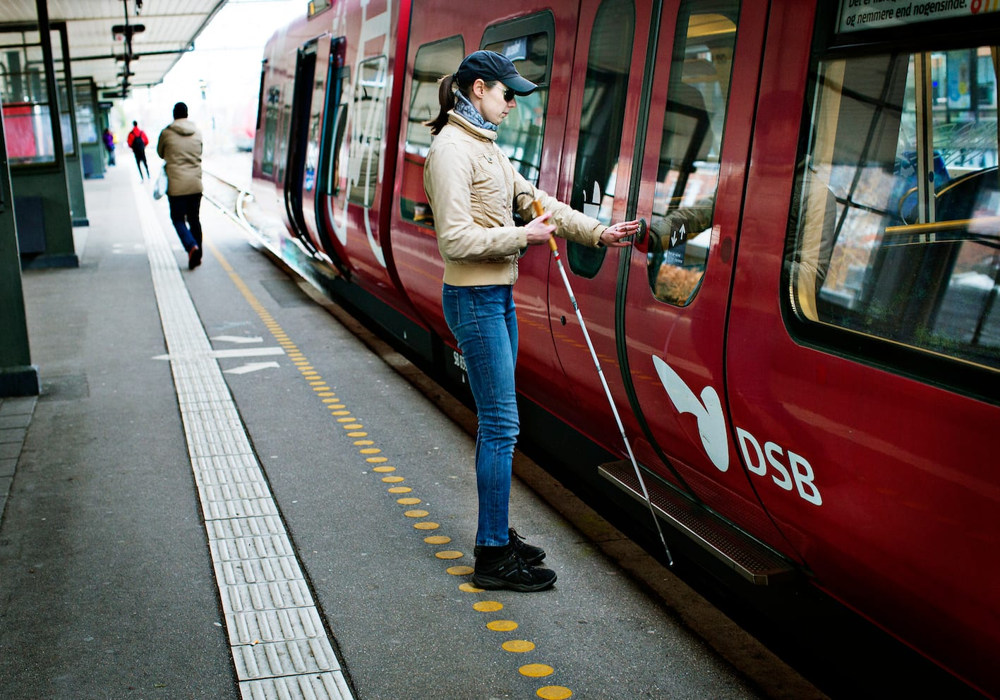
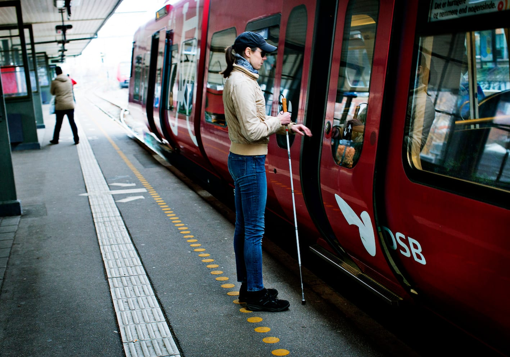

- Lykke tjekker højden og eksistensen af gulvet, før hun træder ind i toget. Dette er vigtigt for at sikre, at hun ikke træder ind i mellemrummet mellem to togvogne.

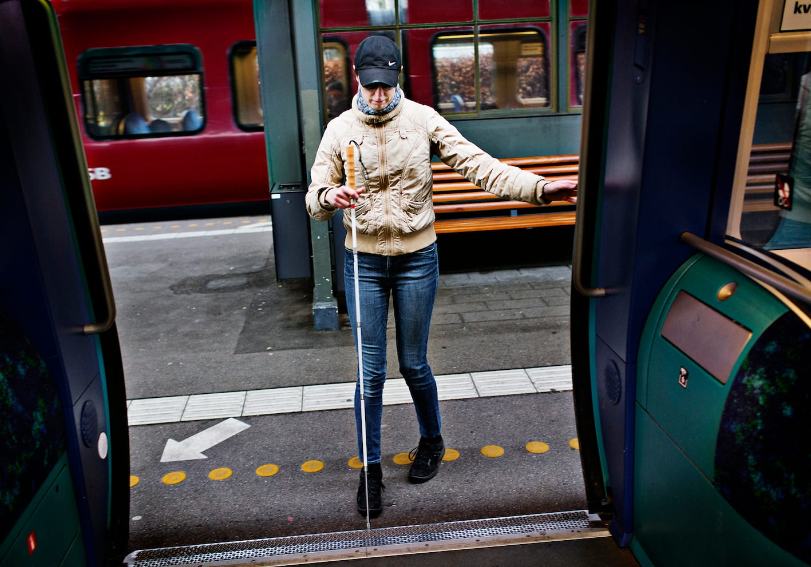
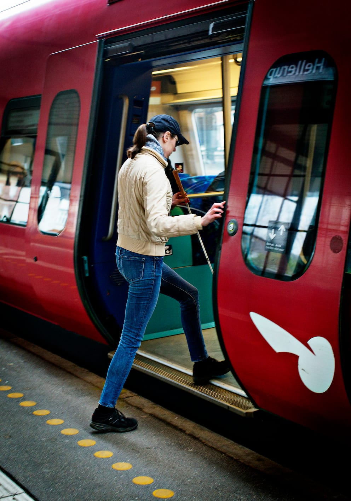

- Inde i toget anvender Lykke pendulteknik med kort stok. Hun finder en plads i nærheden af døren. Hun kan evt. spørge sine medpassagerer.

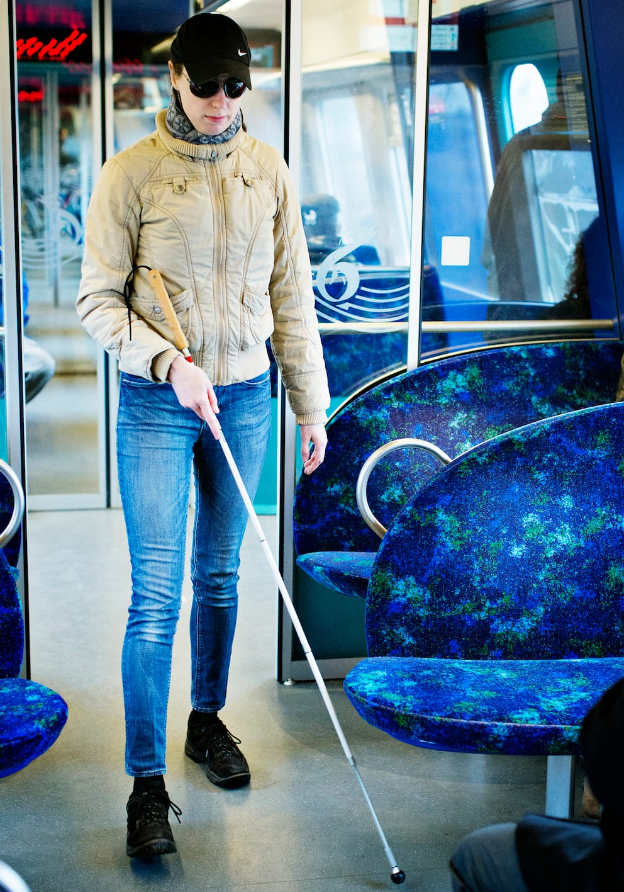
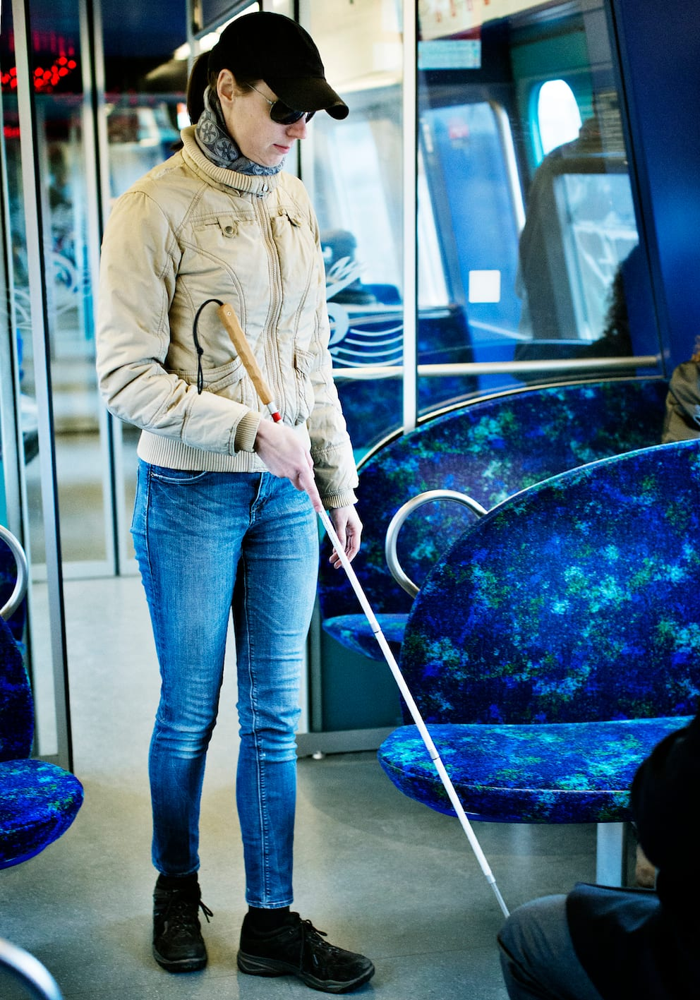

- Lykke undersøger sædet med hånden, før hun sætter sig.

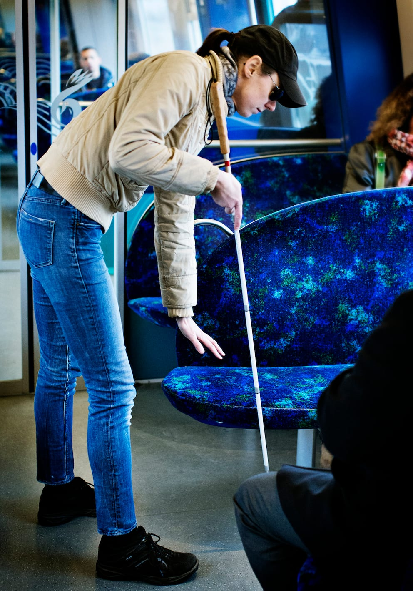
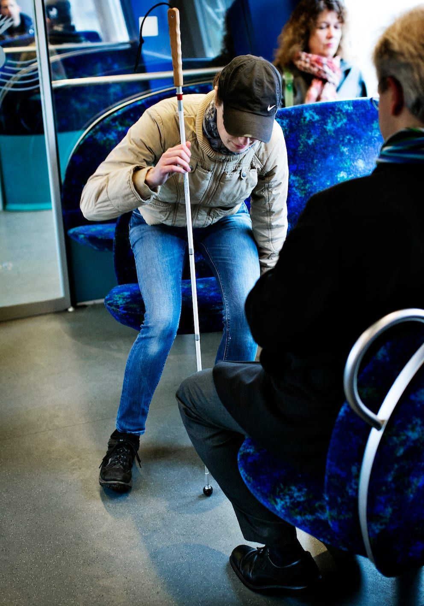

- Det er vigtigt at bemærke kørselsretningen, inden man stiger på toget, da den kan være svær at mærke under kørslen.
