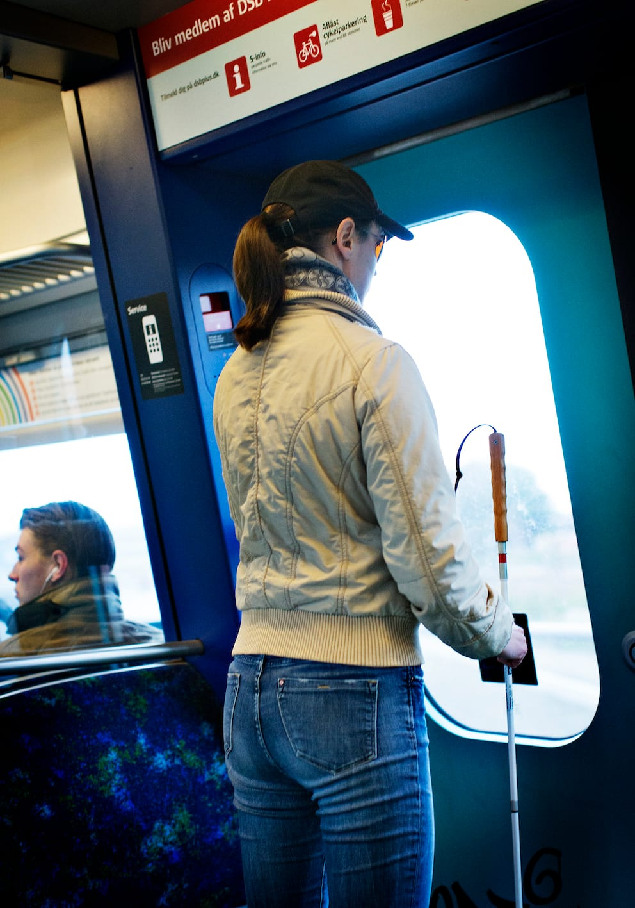
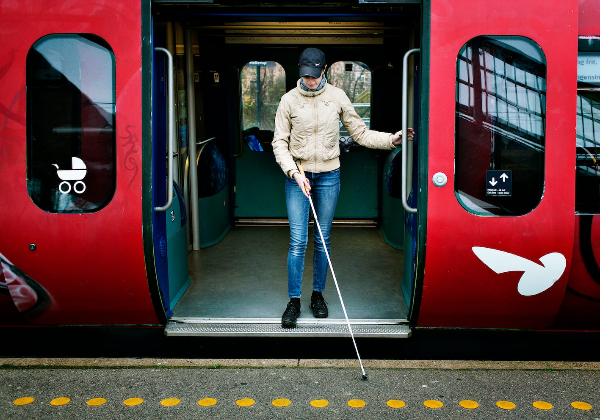
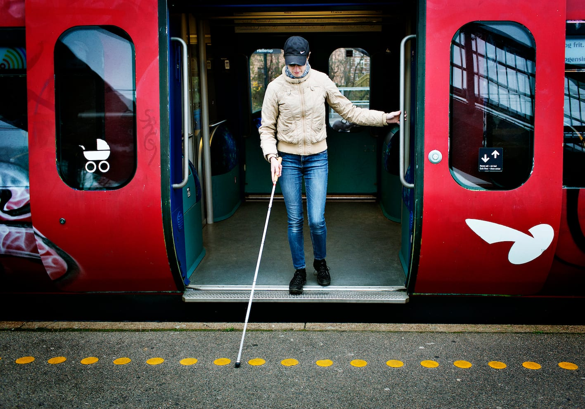
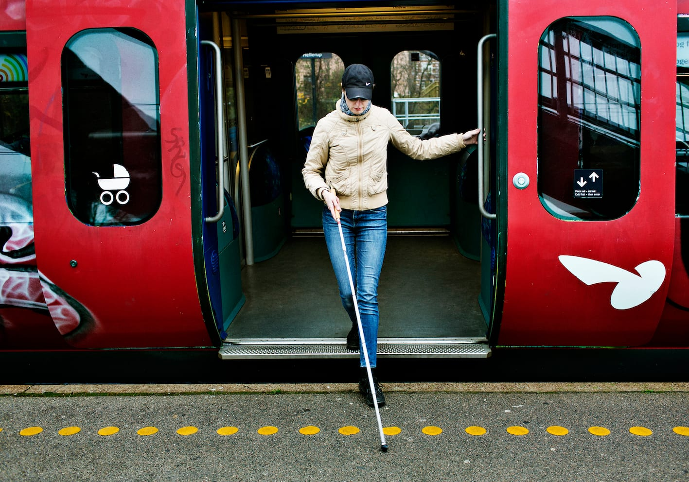

# Udstigning

- Hvis stationerne ikke bliver annonceret, kan Lykke tælle stationerne. Man kan anvende GPS i en eller anden form, kugler i lommen der flyttes fra en lomme til en anden, ”tælleapparat” til strikketøj, eller lignende.

- Lykke stiller sig parat i godt tid ved døren, så hun kan stå ud som den første og evt. følge strømmen af passagerer mod udgangen. I nogle typer tog er det muligt at høre, i hvilken side dørene åbnes, fx ved en fløjtelyd fra den pågældende dør, når den kan åbnes.

- Inden udstigning tjekker Lykke underlaget for at sikre, at toget med sikkerhed holder ved perronen. Hun får samtidigt information om trinnets højde.

