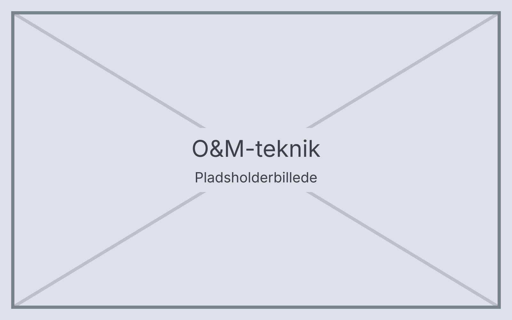

# O&M-teknik

Velkommen til O&M-teknik – en opslagsguide til instruktører i Orientering og Mobility. Guiden beskriver grundteknikker og færden i trafik trin for trin, så du kan bruge den som støtte under undervisningen, også ude på en rute uden internet.

Vælg et emne herunder, eller brug **Søg** øverst på siden til at finde en bestemt teknik.

> Eksempelindhold: teksterne er pladsholdere til afprøvning af appen og skal gennemgås fagligt, før de tages i brug.
